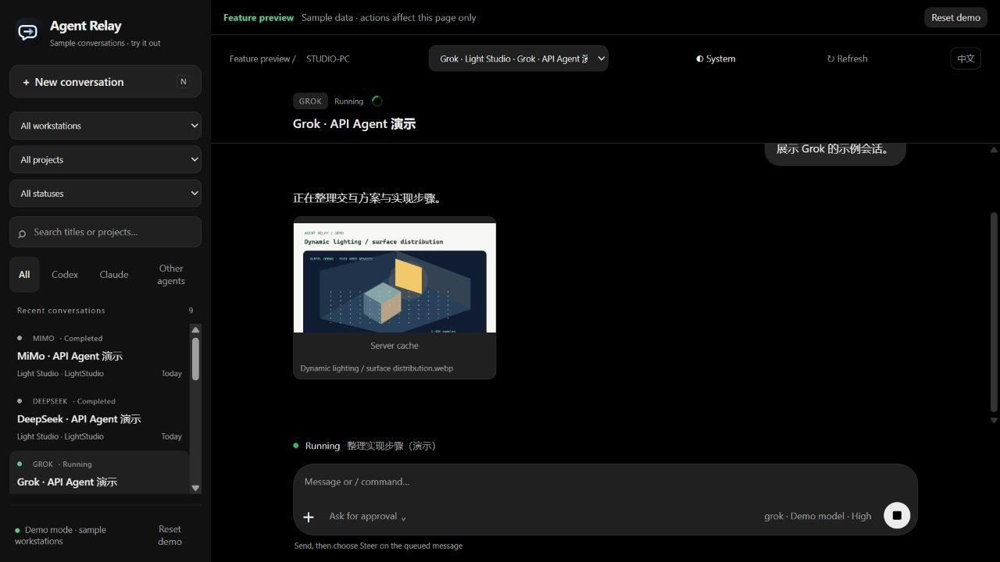
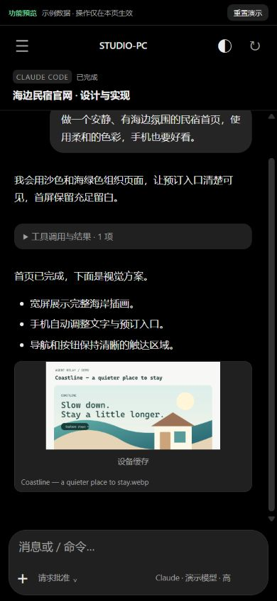
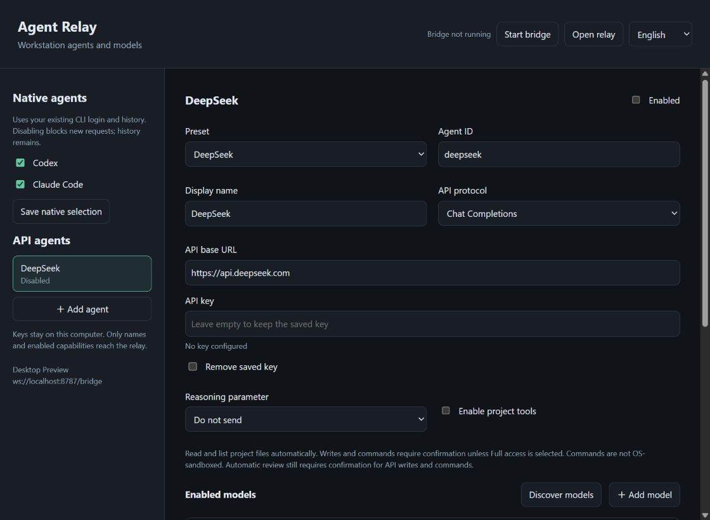

# Agent Relay

[中文](README.md) | **English**

Run Codex / Claude Code on your own computer. Browse, continue, and steer conversations from your phone through your own relay server.

Phone browser → HTTPS / SSE → relay server → WSS → workstation bridge → local agent.

The workstation connects outward to synchronize conversations. Images and attachments use authenticated HTTP transfers and server caching. Agents, workspace files, and model credentials stay on the workstation. The server stores project metadata, conversations, and images or files that are viewed or uploaded; it does not copy the entire workspace.

## Try it and see the interface

**[Open the interactive preview](https://43.161.245.226:8443/preview/)** · No access key required. Works on desktop and mobile.

Explore nine sample Codex / Claude / API agent conversations, two virtual workstations, images, and running, completed, or waiting-for-answer states. Try sending messages, queues, steering, answering questions, model selection, and permissions. Demo actions only affect the current browser page. Reload to reset. The preview does not connect to a real agent.

### Desktop

Filter conversations by device, project, or status. Drag the sidebar edge to resize it. Read conversations and images, follow the current execution step, and send follow-up messages.



### Mobile

Swipe from the left edge to open the conversation list. Tap an image to enlarge it. Select the model, reasoning effort, and permissions from the composer. Appearance follows your system by default.



Screenshots show synthetic content from the isolated demo. See [preview source and deployment instructions](preview/README.md) for details.

## Repository layout

This repository includes the workstation tool, relay server, and website.

| Directory | Purpose |
| --- | --- |
| `src/bridge/` | Workstation connection, native history and Codex project import, agent lifecycle, and steering |
| `src/relay/` | Server authentication, forwarding, SQLite cache, image and file endpoints |
| `src/shared/` | Protocol, path validation, and resource boundaries |
| `web/` | Mobile and desktop UI, with bundled frontend dependencies and no external CDN |
| `desktop/` | Independent workstation manager for agents, API endpoints, and models; keys stay local |
| `preview/` | Independent demo using the same UI with synthetic conversations, images, and browser-local actions |
| `scripts/` | Setup, Windows background/startup helpers, and explicit live-model checks |
| `deploy/` | Docker Compose, systemd, nginx, Caddy, and release templates |
| `test/` | Isolated protocol, boundary, and integration tests |
| `design/` | Icon sources and previews |

## Features

- The operational web UI supports Chinese and English, follows browser language by default, and remembers manual selection. Conversation content and titles stay in their original language.
- An independent desktop window selects enabled agents and models. Keep native Codex / Claude adapters or configure Grok, DeepSeek, MiMo, and custom Chat Completions / Responses endpoints. Keys remain local. See the [desktop and multi-agent guide](docs/local-agents.md#english).
- Browse live and historical Codex / Claude conversations; filter by workstation, project, status, or title.
- Preserve native Codex project IDs, multiple workspace roots, unassigned sessions, and child-session ownership.
- Read available models and reasoning levels; distinguish current settings from presets for the next turn.
- Send messages while tasks run. Persistent queues provide per-message cancellation and steering. Unavailable native channels report their status without opening another writer.
- Command completion for `/help`, `/usage`, `/stop`, `/model`, `/effort`, and Claude `/btw`. Unsupported terminal commands return an explicit error.
- Stream assistant text, collapse tool calls by default, show approval requests, and stop supported tasks.
- Answer single-choice, multiple-choice, and free-text agent questions through dedicated cards. Answers go to the original question, not the normal queue. Answered cards collapse at their original position. Supports managed Codex / Claude, native Codex desktop questions, and asynchronous questions; native Claude terminal questions use an AskUserQuestion hook.
- Import Codex SQLite / Zstd transcripts and Claude JSONL history, with paginated caching, reconnects, and event deduplication.
- Display referenced and generated images, including local image links. Enlarge images and download originals. The UI indicates relay, server-cache, or device-cache delivery.
- Attach photos or files through the system picker; paste images, drag files, or send attachments without text. Up to five attachments and 16 MiB total per message. Images become agent image inputs; other files are saved locally and passed to the agent by path.
- Use previews bounded to 960 pixels on the longest side. Original files and previews are cached separately and scoped to their conversation.
- Compact mobile layout, swipeable sidebar with fading shadows, resizable desktop sidebar, system/light/dark appearance, and expandable titles. Input text uses 16px to avoid mobile focus zoom.
- Show the current public execution step above the composer. Load older history automatically while preserving the reading position and existing image nodes.

## Quick start

Requires **Node.js 24.14+**, npm, and Codex CLI / Claude Code installed and signed in on the workstation. Windows is the primary validated bridge environment. Native desktop steering on other systems is not guaranteed.

```powershell
git clone git@github.com:haiaimi/Agent-Relay.git
cd Agent-Relay
npm ci
npm run setup
npm run relay
```

In another terminal in the same directory:

```powershell
npm run bridge
```

Open <http://127.0.0.1:8787> and sign in with `PHONE_TOKEN` from `.env`. Setup generates separate random secrets and workstation configuration, creating missing files without overwriting existing values.

Codex projects and workspace roots are imported by default and become allowed task directories. Add explicit directories through `projects` in `bridge.config.json`; set `discoverCodexProjects: false` to use only those directories. Path checks resolve symlinks and Windows junctions. The phone cannot choose arbitrary executables or directories.

The workstation uses `BRIDGE_TOKEN`; the browser uses a different `PHONE_TOKEN`. Real `.env`, `bridge.config.json`, model credentials, session databases, uploads, and logs are excluded from Git. Editable example configuration is included.

## Deployment and operation

Run `npm run desktop` to open the local agent/model manager (`scripts/start-desktop.ps1` is also available on Windows). It can reuse or start the workstation bridge; closing the window leaves tasks running. API agents run requests from the workstation and create their own conversations; they do not import provider website chats.



See the **[server, workstation, and website deployment guide](docs/deployment.md)** (Chinese) for HTTPS, Windows background operation and startup, upgrades, rollback, backups, and troubleshooting.

The server runs `dist/relay/main.js` and serves `web/`. The workstation runs `dist/bridge/main.js`. It must remain online to execute tasks or receive attachments. Previously cached conversations and resources remain readable when it is offline.

The browser resource cache is bounded to 64 MiB / 100 items. Signing out clears browser resource caching; server cache remains. For a standalone synthetic preview, see [preview/README.md](preview/README.md).

## Development checks

```powershell
npm run check
npm test
npm run build
```

Tests use isolated directories and simulated protocols without consuming model quota. Run these only when you explicitly want to test real models:

```powershell
# Creates two local test conversations using existing CLI credentials; consumes quota.
npm run smoke:live
# Creates a conversation on a specified relay and verifies follow-ups and model selection.
node --env-file=.env --import tsx scripts/verify-remote.ts https://relay.example.com:8443
```

Verification output is saved under ignored `.data/`. See the [validation record](docs/validation-2026-11-02.md) (Chinese) for completed checks and remaining limits.

## Compatibility and limits

- Managed Codex uses `turn/steer`. The Windows native adapter targets Codex **26.1013.4894**, using IPC v1 for discovery/steering and v2 for idle follow-ups. Native Claude steering targets **Claude Code 2.1.316 / peer protocol 1**. Managed Claude steering aborts the turn, waits for SDK cleanup, and resumes the same session. Revalidate after CLI or desktop upgrades; incompatible CLI / IDE sessions remain queued.
- Native state is polled roughly every 15 seconds and depends on observable processes and logs. Managed tasks push events in real time. Deliveries with uncertain results are never automatically resent.
- `/btw` uses a nonpersistent branch without interrupting the main conversation. Some usage and side-question interfaces are experimental. Restart existing Claude terminals after installing the question hook. Special MCP forms, URL checks, and additional permission requests may still require local interaction.
- History is a paginated display cache, not a byte-for-byte transcript backup. Large messages may be truncated. Audio, full internal reasoning, and some special tool outputs are not displayed. Referenced images support PNG/JPEG/GIF/WebP up to 16 MiB each; remote image URLs are shown as links rather than fetched automatically.
- Closing the browser does not stop agents. Exiting the bridge stops processes it owns. The guardian reconnects but does not automatically rerun interrupted work. There is no offline service worker.
- Current resource transfers use authenticated HTTPS and the workstation's existing WSS connection. Duplicate cold reads are coalesced, with at most three concurrent resource jobs. The current UI does not wait for STUN/ICE/TURN; legacy direct-transfer endpoints remain for older clients. No public workstation HTTP file server is needed.
- Intended for a single trusted user. There is no multi-user authorization, per-device pairing, key-rotation UI, or automatic data cleanup. Anyone holding the browser access key can operate allowed projects.
- **The server can read and cache conversations and resources.** Disk files and the database are not encrypted. Transfers retain HTTPS/WSS and login authentication, but do not use additional end-to-end encryption. Only explicitly referenced or uploaded resources are synchronized. Never upload model credential files; restrict data-directory permissions and plan backups and storage monitoring.

## Dependencies and references

Bundled frontend copyrights and licenses are listed in [THIRD_PARTY_NOTICES.md](THIRD_PARTY_NOTICES.md). No project-wide open-source license has been selected.

These projects informed architecture research; their source code was not copied:

- [si-mods/gorex](https://github.com/si-mods/gorex), researched at `bd3d919bac76c73eaad906d80d50015533923a47`: local execution, persistent sessions, and remote-control boundaries.
- [yetone/magpie](https://github.com/yetone/magpie), researched at `838d12d6f876cfca67d6127950311a9647b1f2e2`: native sessions and history browsing.

Local agent integrations use Codex app-server and the Claude Agent SDK. Dependency versions are pinned in the lockfile.
