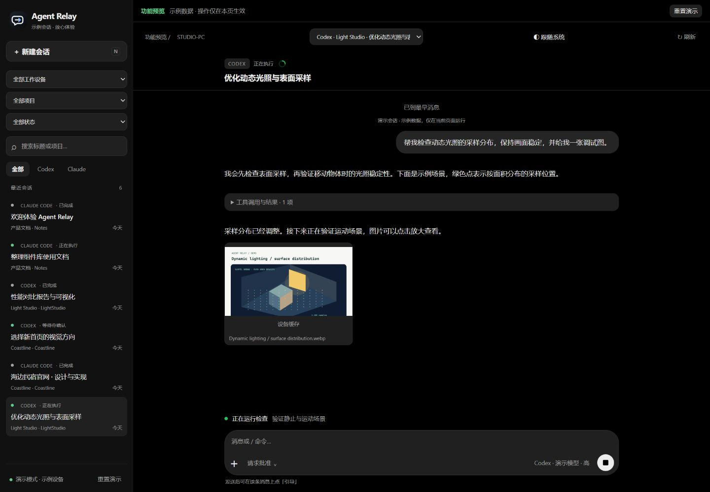
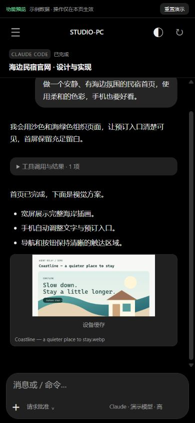

# Agent Relay

**中文** | [English](README.en.md)

在自己的电脑运行 Codex / Claude Code，通过自己的服务器和手机网页浏览、继续和引导会话。

手机网页 → HTTPS / SSE → 中转服务器 → WSS → 电脑端连接工具 → 本地 Agent。

电脑主动连接服务器同步会话；图片与附件通过服务器 HTTP 接口收发和缓存，手机无需等待直连建链。Agent、工程文件和模型登录凭据留在电脑上；服务器保存项目结构、会话及被查看或上传的图片/附件，不复制整个 workspace。

## 在线体验与界面

**[打开功能预览站](https://43.161.245.226:8443/preview/)** · 无需密钥，电脑和手机均可访问。

预览包含 6 个 Codex / Claude 示例会话、两台虚拟设备、图片，以及运行中、已完成和等待回答状态。可以体验发送、排队、逐条引导、问题回答、模型及权限设置；所有操作仅影响当前页面的演示数据，刷新即可恢复。预览不连接真实 Agent。

### 电脑网页

左侧按设备、项目和状态切换会话，拖动侧栏边缘调整宽度；右侧查看会话、图片、当前执行步骤并继续输入。

### 手机网页

从左边缘拖开会话列表，点选会话后继续阅读；点击图片放大，输入框内可调整模型、思考强度和权限。外观默认跟随系统。

截图来自独立预览站，展示的是合成示例内容。预览站源码与部署说明见 [preview/README.md](preview/README.md)。

## 工程组成

这是完整工程，包含电脑端工具、服务器和网站，无需另找前端仓库。

| 目录 | 内容 |
| --- | --- |
| src/bridge/ | 电脑端连接、原生历史与 Codex project 导入、Agent 生命周期和引导 |
| src/relay/ | 服务器鉴权、消息转发、SQLite 缓存、图片及文件接口 |
| src/shared/ | 消息协议、路径及资源边界检查 |
| web/ | 手机与桌面网站，包含本地前端依赖，无外部 CDN |
| preview/ | 与正式 UI 同源的独立演示站，含合成会话、图片和本地模拟交互 |
| scripts/ | 配置初始化、Windows 后台运行/登录自启动、显式模型验证 |
| deploy/ | Docker Compose、systemd、nginx、Caddy 和发布脚本模板 |
| test/ | 隔离环境中的协议、安全边界与集成测试 |
| design/ | 图标设计源文件与预览 |

## 功能

- 统一浏览 Codex / Claude 的实时及历史会话，按工作设备、项目、状态和标题筛选。
- 保留 Codex 原生 project ID、项目名、多个 workspace 根目录、无项目状态及子会话归属。
- 查询本机可用模型和思考强度；运行中修改作为下一轮预设。
- 运行中输入及持久排队，每条消息可取消或引导；通道不可用时显示原因，不另起写入者。
- 命令自动补全，支持 /help、/usage、/stop、/model、/effort 和 Claude /btw；未适配的终端命令明确报错。
- AI 文字流式显示，工具调用默认折叠，支持审批和停止。
- Agent 提问显示独立回答卡片，支持单选、多选和自填；刷新保留草稿，提交直达原提问，不进入普通消息队列。支持网页管理的 Codex / Claude、Codex 桌面原生提问及异步问题；Claude 终端通过专用 AskUserQuestion hook 接入。
- Codex SQLite / Zstd 日志及 Claude JSONL 历史导入，后台分页缓存，断线重连和事件去重。
- 传输会话引用的图片、Agent 生成的图片及图片工具展示的效果图，支持放大；本地图片链接也显示预览。通过服务器传输，页面区分服务器中转、服务器缓存和设备缓存。相机、照片、文件选择，以及粘贴图片、拖入附件、仅附件发送，每次最多 5 个附件、合计 16 MiB。
- 列表使用最长边 960 像素的预览图；放大和下载读取原文件。原图与预览独立缓存，减少手机首次加载流量。
- 图片进入 Codex / Claude 图像输入；普通文件在本地保存并以路径交给 Agent。附件跟随排队和引导，预览与下载按会话隔离。
- 手机紧凑布局、单行可展开标题、模型及权限弹窗、侧边栏左右拖动与阴影渐变；电脑侧栏可拖动调宽。明暗外观默认跟随系统，也可手动选择。
- 输入框使用 16px 字号；执行步骤显示在输入框上方，空输入时可停止当前任务，有输入时显示发送按钮。历史下拉自动加载，图片占位与消息节点保持稳定；已回答的问题在原触发位置折叠。

## 本地快速启动

需要 Node.js **24.14+**、npm，以及在电脑上已安装并登录的 Codex CLI / Claude Code。当前电脑端主要验证环境为 Windows；其他系统的原生桌面引导能力不保证可用。

~~~powershell
git clone git@github.com:haiaimi/Agent-Relay.git
cd Agent-Relay
npm ci
npm run setup
npm run relay
~~~

另开终端，在同一目录执行：

~~~powershell
npm run bridge
~~~

打开 <http://127.0.0.1:8787>，用 .env 中的 PHONE_TOKEN 登录。setup 生成随机密钥与本机配置，只生成缺失文件，不覆盖已有值。

默认导入 Codex 项目及 workspace 根目录，并允许在这些目录发起或恢复任务。通过 bridge.config.json 的 projects 添加允许目录；设 discoverCodexProjects: false 可仅使用显式目录。目录检查会解析符号链接 / junction；手机不能指定任意程序或目录。

电脑使用 .env 中的 BRIDGE_TOKEN 连接服务器；手机使用不同的 PHONE_TOKEN。真实 .env、bridge.config.json、会话数据库、上传文件和日志均不入库。仓库内提供可修改的示例配置。

## 部署与运行

完整步骤见 **[服务器、电脑端和网站部署文档](docs/deployment.md)**，包括 HTTPS、Windows 后台运行与登录自启动、更新回退、备份和故障排查。

服务器只启动 dist/relay/main.js，同时提供 web/ 网站；电脑启动 dist/bridge/main.js。电脑保持开机联网才能执行或接收附件；电脑离线时可查看服务器已缓存的会话及图片/文件。设备资源缓存最多 64 MiB / 100 项；退出登录清除此网页的资源缓存，服务器缓存继续保留。

## 开发验证

~~~powershell
npm run check
npm test
npm run build
~~~

自动测试使用隔离目录和模拟协议，不消耗模型额度。明确需要真实模型验证时再执行：

~~~powershell
# 新建两个本地测试会话，使用已有 CLI 登录，会消耗模型额度
npm run smoke:live
# 对指定服务器新建会话并验证续聊、模型切换
node --env-file=.env --import tsx scripts/verify-remote.ts https://relay.example.com:8443
~~~

验证脚本的输出保存在忽略的 .data/ 中。已完成及尚待验证的范围见 [验证记录](docs/validation-2026-11-02.md)。

## 兼容性与边界

- 网页管理的 Codex 通过 turn/steer 引导；Windows 原生桌面适配针对 Codex **26.1013.4894**，发现/引导使用 IPC v1，空闲续聊使用 v2。Claude 原生引导适配 **Claude Code 2.1.316 / peer protocol 1**；网页管理的 Claude 通过中止本轮、等待 SDK 清理、恢复同一会话处理引导。CLI / 桌面升级后应重新验证；独立 CLI / IDE 没有兼容通道时仍只能排队。
- 原生状态约 15 秒轮询，受进程与日志观察范围限制；网页管理任务通过事件实时推送。投递结果不确定的操作不会自动重发，避免重复执行。
- /btw 使用非持久分支旁问，不打断原会话；部分用量与旁问接口仍属实验能力。Claude 终端问答接入见部署文档，已打开的旧终端需重开；特殊 MCP 表单、URL 验证和额外权限申请仍需本机处理，不自动批准。
- 历史是网页可展示内容的分页缓存，不是原始日志逐字节备份。大消息有截断；音频、完整思考内容与部分特殊工具类型尚未展示。会话引用图片只支持 PNG/JPEG/GIF/WebP，单张最多 16 MiB；远程图片 URL 仅显示链接，不代为下载。
- 关闭网页不会停止 Agent；连接程序退出会停止它启动的进程。守护程序只恢复连接，不自动重新执行中断任务。没有离线 Service Worker，手机仍需连接服务器。
- 当前网页使用 HTTPS 下载/上传二进制内容，服务器按需从现有电脑 WSS 通道取图并缓存；相同冷资源请求合并，最多并行 3 个资源任务。不再等待 STUN/ICE/TURN。旧版直连接口暂留作客户端兼容，当前网页不调用；无需暴露电脑的 HTTP 文件服务。
- 当前供单人可信设备使用，无多用户权限、逐设备配对、密钥轮换界面或数据自动清理。持有手机密钥的人可操作允许项目。
- **服务器可以读取并缓存会话及资源内容**，磁盘文件和数据库不加密；传输保留 HTTPS/WSS 和登录鉴权，当前模式不使用额外端到端加密。只同步会话明确引用或用户上传的资源。模型登录文件不得上传；限制数据目录权限并安排备份与容量监控。缓存不会自动清理。

## 依赖与参考

前端内置依赖的版权和许可证见 [THIRD_PARTY_NOTICES.md](THIRD_PARTY_NOTICES.md)。尚未为本项目指定开源许可证。

以下项目用于架构调研，未复制其源码：

- [si-mods/gorex](https://github.com/si-mods/gorex)，研究版本 bd3d919bac76c73eaad906d80d50015533923a47：本地执行、持久会话和远程控制边界。
- [yetone/magpie](https://github.com/yetone/magpie)，研究版本 838d12d6f876cfca67d6127950311a9647b1f2e2：原生会话与历史浏览。

本地 Agent 接口使用 Codex app-server 和 Claude Agent SDK，具体版本由依赖锁文件固定。
