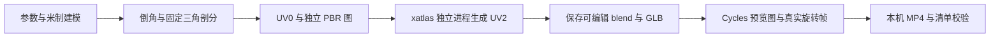
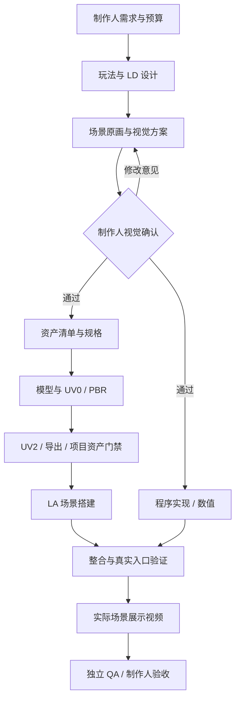

# 资产生成管线与换机搭建

本指南把 Agent Relay 的制作流程、可复现工具环境，以及 LightGame 的项目资产管线分开说明。新电脑不再依赖旧电脑的 `captures`、全局 Python 或固定盘符。

## 新电脑：从拉代码到第一件资产

先安装 Git、Node.js 24.14+。首次只做本地资产不需要服务器密钥或 Agent 登录。

```powershell
git clone --branch codex/initial-bridge git@github.com:haiaimi/Agent-Relay.git
cd Agent-Relay
npm ci
npm run assets:setup
npm run assets:doctor
npm run assets:demo
```

`assets:setup` 下载 **Blender 4.5.15 LTS 便携版**，核对仓库锁定的官方 SHA-256，解压到本仓库 `.data/asset-tools/`。使用 Blender 自带的 Python 3.11 创建 venv，再从 PyPI 安装锁定版本和哈希的二进制 wheel。不会修改系统 PATH、全局 Python、现有 Blender 或游戏工程。Windows x64、macOS ARM64 / x64、Linux x64 有安装分支；**本次真实验证平台为 Windows x64**，其他平台仍需对应机器验证。Windows ARM64 当前没有完整依赖组合，不声明支持。

已安装同版本 Blender 时也可显式复用：

```powershell
npm run assets:setup -- --blender 'D:/Tools/Blender-4.5.15/blender.exe'
```

此时 Blender 只读复用，新 venv 仍在 Relay `.data` 内。Blender 版本不符会报错，不悄悄切换。不要移动安装目录后继续使用旧 venv；换电脑或移动仓库后重新运行 setup。

下载和 pip 的连接类失败最多尝试 5 次，每次间隔 60 秒。校验值不符、缺少对应 wheel 或命令参数错误直接报错；资产制作、审批、发布和任务启动不自动重放。已完成的工具和下载缓存可复用，再次 setup 不删除旧成果。中断的解压暂存目录保留供排查。

### 安装内容与保存位置

| 内容 | 版本 / 用途 |
| --- | --- |
| Blender | 4.5.15 LTS；后台建模、材质、GLB 导出、Cycles 渲染 |
| Python | Blender 随包的 3.11；独立 venv，不需要另装 Python |
| numpy / scipy | 2.2.6 / 1.15.3；网格与数值处理 |
| Pillow | 11.3.0；参数图、图片读取与校验 |
| xatlas | 0.0.11；UV2 展开打包，独立进程执行 |
| shapely | 2.1.1；UV/几何检查所用依赖 |
| imageio-ffmpeg | 0.6.0；自带 FFmpeg，生成本机 H.264 MP4 |

版本来源为 [`toolchain.lock.json`](../tools/asset-pipeline/toolchain.lock.json) 和 [`requirements.lock`](../tools/asset-pipeline/requirements.lock)。升级时显式修改锁文件并重新验证，不自动跟随 latest。

```text
Agent-Relay/
  tools/asset-pipeline/           # 入库：工具锁、制作示例、UV2 worker、输出验证器
  scripts/asset-pipeline.mjs      # 入库：安装 / 检查 / 制作 / 项目管线入口
  .data/asset-tools/              # 不入库：本机 Blender、venv、下载缓存
    local.json                   # 当前机器配置与锁文件身份
    studio-toolchain.json        # 可填入工作室团队设置的本机路径
    doctor.json                  # 实际路径、版本、模块、FFmpeg 和工具可用性
  .data/asset-output/demo-*/      # 不入库：每次示例的独立输出，永不覆盖旧执行
```

`.data` 内不包含“拉代码即可获得”的正式资产。正式游戏资源、建模脚本、recipe、源 `.blend` 和必要贴图需要另行纳入**游戏工程仓库**；大文件按该工程的 Git LFS 约定管理。不要用复制整个旧电脑 `.data` 或会话数据库代替工程版本管理。

## 第一件示例资产做了什么

`assets:demo` 制作一个 0.8 × 0.8 × 1.8 米石柱，执行：



输出包括：

| 文件 | 内容 |
| --- | --- |
| `source.blend` | 可编辑源模型、材质、灯光、相机；贴图已打包，可单独打开 |
| `asset.glb` | 实际模型、法线、UV0 / UV2 与材质 |
| `textures/*.png` | 独立 Albedo、Normal、Roughness、Metallic、AO 源图 |
| `preview.png` | 实际 Cycles CPU 渲染图 |
| `showcase.mp4` | 默认 48 帧 / 24fps 的实际转台渲染，H.264、yuv420p、faststart |
| `frames/` | 真实渲染帧，留在本机 |
| `manifest.json` | 尺度、面数、UV2 参数、材质约定及产物 SHA-256 |
| `verification.json` | 文件哈希、图片解码、GLB buffer/UV2 和视频全量解码检查 |
| `execution.json` / `blender.log` | 本次脚本身份、工具锁、输出路径和完整 DCC 日志 |

示例使用固定随机种子和简单程序材质，Normal 是明确标注的平面法线；它用于验证新电脑能完成制作，不是已经获得制作人批准的正式美术。UV2 存在且坐标有效，也不等于岛无重叠、密度合适或真实 receiver 覆盖通过。

运行自己的 Blender 制作脚本：

```powershell
npm run assets:run -- --script 'D:/GameWorktree/tools/build_prop.py' --out 'D:/GameWorktree/.studio/prop-v1'
# 也可向脚本传参；直接使用 node 可避免 npm 对多个 -- 的转发差异
node scripts/asset-pipeline.mjs run --script 'D:/GameWorktree/tools/build_prop.py' --out 'D:/GameWorktree/.studio/prop-v2' -- --variant stone
```

脚本从 Blender `--` 后接收 `--out`，必须只向该目录或本任务允许目录输出。可从 [`demo.py`](../tools/asset-pipeline/demo.py) 起步；它把 xatlas 放进 [`unwrap.py`](../tools/asset-pipeline/unwrap.py) 子进程，避免 Windows 下与 Blender 的 C++ 运行库发生冲突。`assets:run` 保存真实退出状态和日志，但不会用示例验收器替自定义模型宣称通过；自定义脚本需交付自己的清单和检查。

输出目录必须不存在。失败后保留现场，检查 `blender.log`，修正后选择新的输出目录；不删除旧失败记录、不自动重新制作。

## 接入游戏团队工作室

1. 在新电脑安装并登录需要的 Claude / Codex，按 [部署指南](deployment.md) 配置 bridge、服务器地址、唯一设备 ID 和本机项目目录。不要复用旧电脑的设备 ID。
2. 拉取实际游戏仓库及其子模块 / LFS 资源，在该电脑登记工程。只有 Relay 仓库不会包含 LightGame 源码、定制引擎或所有生产资产。
3. 执行上述 `assets:setup` 和 doctor。创建/配置团队时，选择这台电脑和实际工程路径。
4. 展开团队「共享工具环境」，把本机 `.data/asset-tools/studio-toolchain.json` 的 Blender、Python、Python 依赖目录、探测脚本路径填入对应字段；定制引擎另填真实路径。不要将旧电脑路径原样复制。
5. 在职能工具说明填写本仓库绝对路径、制作脚本和实际项目规范。新需求仍创建独立分支/工作副本，所有资产输出落在该副本。

`discover-studio-tools.mjs` 会自动读取**它所在 Relay 仓库**的默认 `studio-toolchain.json`；显式工具参数优先。使用自定义工具目录时，可传 `--toolchain`：

```powershell
node scripts/discover-studio-tools.mjs --project 'D:/GameWorktree' --toolchain 'D:/Tools/relay-assets/studio-toolchain.json' --needs blender,python,xatlas,shapely
```

工具预检是只读操作，不在制作任务中自动全局安装或改变团队权限；发现缺失时返回实际检查范围及恢复步骤。

## 当前生产工作流

按本需求勾选的流程执行，以下为完整场景流程；只做资产或只做关卡可裁剪。



程序实现只有一套，整合阶段复用已实现代码。复用资产只补本次必要的检查，不强制重新建模；已有冷加载、UV2/receiver 等缺口仍不能省略。审批不通过时按制作人意见回到对应阶段，保留旧版本、记录和会话。详见 [工作室流程](game-studio.md)。

## LightGame / Borrowed Light 正式项目管线

已检查的 `LightGame-main/project` 提供 `Asset-Pipeline.ps1`，统一入口实际调用 `tools/unified_asset_pipeline.py`；`Image-To-Asset.ps1` 是兼容入口。`captures/asset-pipeline-dcc`、`captures/asset-pipeline-deps` 是旧的本机缓存位置，不能作为换机前提。

| 操作 | 实际用途 |
| --- | --- |
| `intake` | 参考图片入库、记录来源和分析任务；不宣称已重建模型 |
| `image` | 已有图像任务 + 针对该任务编写的 Blender model script → 模型与项目门禁 |
| `build` | 已有 recipe / 源资产 → 几何、PBR、UV2、receiver / Surfel 离线包 |
| `publish` | 将已核验的包显式接入项目；不是制作成功后自动执行 |

新电脑先拉取**匹配的游戏工程提交和引擎子模块**，按游戏仓库说明取得/构建定制引擎。不能用官网 Godot 替代带有项目 GI 功能的引擎。保留构建来源、二进制哈希及同一份源码对应关系。

Relay 新入口可以直接调用游戏工程现有 Python 管线，使用本次已检查的 venv，避免被旧 `captures` 内的 Python 包抢先覆盖：

```powershell
# 使用需求 worktree；路径全部换成本机的真实位置
node scripts/asset-pipeline.mjs project --project 'D:/GameWorktree' --engine 'D:/GameWorktree/engine/bin/custom-godot.exe' -- build --recipe 'D:/GameWorktree/project/assets/my-prop/recipe.json' --out 'D:/GameWorktree/.studio/build-v1'

# 从参考图任务制作：model script 必须针对参考图的实际形体编写
node scripts/asset-pipeline.mjs project --project 'D:/GameWorktree' --engine 'D:/GameWorktree/engine/bin/custom-godot.exe' -- image --job 'D:/GameWorktree/.studio/intake/job.json' --model-script 'D:/GameWorktree/project/tools/model_my_prop.py' --out 'D:/GameWorktree/.studio/image-build-v1'
```

可以直接传游戏根目录或其中的 `project` 目录。这个入口复用游戏仓库的管线，**不会另做一套正式 receiver / Surfel 实现**。recipe 格式、模型脚本的项目契约和项目命令以该工程当前版本为准；相关规范应随游戏仓库入库：

- `project/docs/development/unified-asset-pipeline.md`
- `project/docs/development/image-to-asset-pipeline.md`
- `project/docs/development/asset-development-pipeline.md`
- `project/docs/development/pbr-asset-standard.md`

正式验收需覆盖：最终几何与手游预算 → 配准的独立 PBR → UV2 唯一性/退化/密度/薄面和过滤覆盖 → receiver 重烘 → 全场 Surfel / cell 完整引用 → 实际材质绑定 → 冷导入 → 指定新场景实拍 → 目标设备表现。只读工具预检、GLB 导出、示例转台或单资产通过都不能代替这些结果。

Blender/依赖缺失属于环境问题；引擎来源不匹配属于 provenance；上游文件变化需核对任务启动时最新交付；receiver 缺失或画面不符属于质量问题。分别报告 `category/code/details/remedy`，不能把所有情况都归为“找不到 Blender”。

## 换机带走什么

| 拉取 / 重新生成 | 不从旧机复制 |
| --- | --- |
| Relay 源码、锁文件和本文 | 旧机 venv、绝对路径、整个 captures |
| 游戏仓库、子模块、LFS、建模脚本、recipe、源资产 | 另一台电脑的设备 ID / Agent 凭据 |
| 与项目匹配的定制引擎和构建记录 | 用任意官网引擎冒充定制构建 |
| 重新 setup 的 Blender、Python 包、本机工具配置 | Relay `.env`、会话数据库作为公共仓库文件 |

要迁移**正在进行的需求**，还需要原 worktree 中尚未入库的源文件、产物及任务状态；拉取 Git 只能恢复已入库内容。先在原机保存/归档该需求，再选择恢复路径，不在新机假装已有断点。仅新增设备从新需求开工，不影响旧电脑正在运行的任务。

展示视频保存在本机或本需求 worktree，工作室通过既有鉴权媒体通道流式中转；服务器不持久保存视频。工作电脑离线时，本机视频无法播放。

## 验证范围与来源

本次在 Windows x64 使用 Blender 4.5.15 的真实后台进程验证，依赖新建到隔离 venv，示例实际导出 108 个三角形的 GLB、UV0/UV2、PNG 和 48 帧转台 MP4，完成文件哈希及视频全量解码。项目定制引擎、正式 receiver 和手机运行没有由此重新验收。

Blender 包与 SHA-256 来自 [Blender 官方 4.5 下载目录](https://mirror.blender.org/release/Blender4.5/)，包依赖来自 [PyPI](https://pypi.org/)。导出参数参考 [Blender 4.5 glTF 导出文档](https://docs.blender.org/manual/en/4.5/addons/import_export/scene_gltf2.html)。
