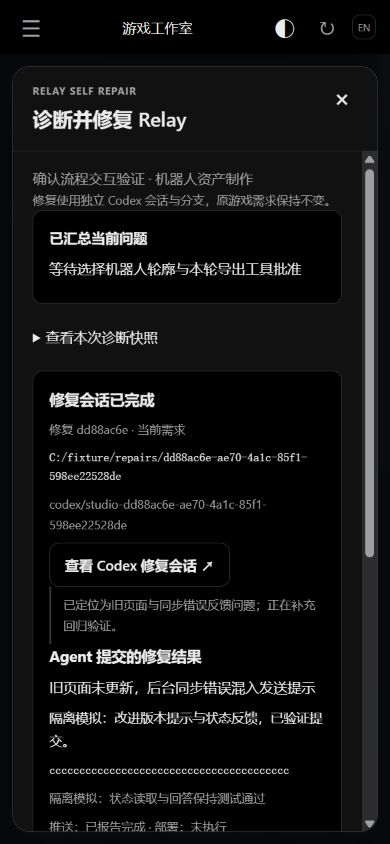

# Relay 自修复

工作室的需求详情和任务详情，在“当前流程进度”旁提供 **诊断并修复 Relay**。卡在状态刷新、会话投递或流程分发时，从当前页发起，不必重新手动整理问题。

## 使用

1. 点击入口，查看自动汇总的服务器当前状态、阻断原因与可展开的诊断快照；可补充复现步骤。截图和旧网页的状态只作为待核实证据。
2. 默认选择已登记、支持工作副本和 Codex 的 Agent Relay 工程。可换修复电脑、Codex 模型和会话权限；配置自动保存。
3. 点击“开始诊断并修复”。原游戏需求、会话与审批保留，另外准备 Relay 修复分支和工作副本，启动 Codex。
4. 在同一窗口查看准备、启动、执行、等待确认和最终结果。修复 Agent 的问题与工具批准也在此显示；完整会话可继续引导。

修复后默认提交并推送独立分支，可关闭推送。**验证后部署到当前 Relay 服务器**默认不勾选，选中后才授权此次 Agent 按现有部署流程发布已验证修复；配置会记住。未选部署时交付提交和部署步骤，不声称线上已修复。不会自动合并主干或强推。

## 修复范围

Agent 必须先区分 Relay 缺陷、设备离线、旧网页、合法审批，以及实际业务交付不合格。例如缺少实际原画、视觉质量未通过时，不能删掉验收检查、把任务改成完成，或自动代替制作人审批。若并非 Relay 缺陷，返回原因和正确处理建议，不制造空改动或空提交。

修复复用现有 bridge 的 `prepare-workspace` 和 `start`，固定为 Codex。修复分支形如 `codex/studio-<修复ID>`，实际路径显示在页面上。源 Relay 仓库及其未提交修改保留，修复在新工作副本中进行；游戏源工程和资产不在修改范围内。

部署需核对当前 release、备份流程数据、保留线上补丁并验证就绪与公网请求，失败回滚。不重启正在执行任务的电脑 Agent。只有所选部署完成且健康校验通过后，才可用现有受校验的恢复接口核对原任务与恢复分发，不绕过审批或重复启动已完成工作。

## 幂等、断线和恢复

- 修复记录与设置保存到服务器 SQLite 的 `relay_repairs`、`relay_repair_settings`，网页关闭或服务器重启后保留。
- 同一个 Relay 工程存在执行中或投递待确认的修复时，再次点击复用该记录，避免同时启动多个修复写入者。
- 电脑离线、尚未投递时按一分钟间隔最多尝试五次。准备或启动已发出、结果不明时不盲目重发，保留操作日志和工作副本。
- 启动结果不明时可从同一修复工作副本的候选列表绑定核对后的会话；确认确实未启动时，点击“核对修复未启动”并再次确认，解除等待，保留旧现场再发起。
- Agent 退出不等于修复完成。需要完整结果、实际验证及所选的提交、推送、部署记录。页面明确标为“Agent 提交的修复结果”，不能替代对目标游戏画面的制作人验收。

服务器完全不可达时无法经它分发新 Agent，需要先恢复连接。修复不增加任意远程 shell 接口，也不在诊断里传送令牌、私钥或整个环境文件。错误快照对常见凭据格式脱敏，工具进度不包含原始命令参数。

## 实现与验证

受现有登录保护的接口：`GET/POST /api/studio/repairs`、`POST /api/studio/repairs/bind` 和 `POST /api/studio/repairs/resolve`。创建接口立即返回 202 和持久化记录，后台准备工作副本、启动会话；问题回答和工具批准继续走 `/api/actions`。修复不会创建一个带额外游戏审批的 Studio 需求，也不会递归发起自修复。

单测覆盖独立工作副本、固定 Codex、原游戏状态不变、目标校验、敏感字段脱敏、重复点击、服务重启、启动不确定性、离线退避、结构化结果与跨工作副本的修复问题展示；HTTP 验证鉴权、202 回执及幂等创建。隔离浏览器验证点击入口、模型选项、启动进度与结果展示，不调用真实模型或批准正式游戏任务。网页有版本差异时显示更新提示，避免旧页面长期使用过期操作。

下图为隔离模拟数据，不是实际修复提交或正式制作结果。

